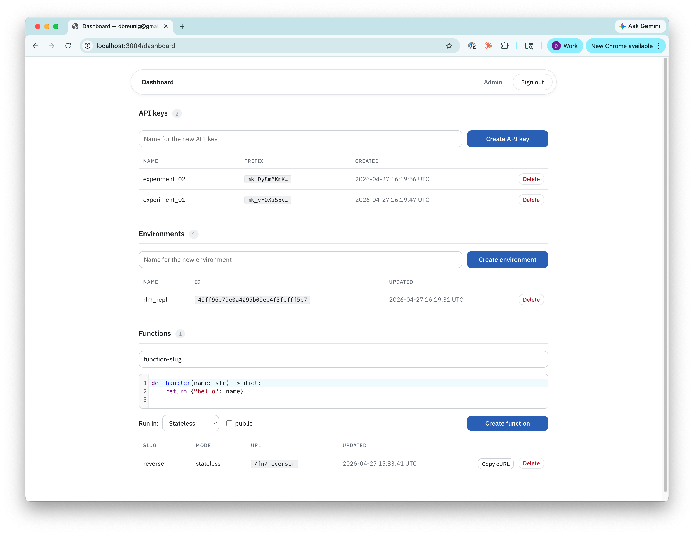

# monty-server

Self-hostable web server exposing the [Monty](https://github.com/pydantic/monty) Python
interpreter as a multi-tenant service. Users sign in with GitHub, create persistent
sandboxed Python environments, and run code via a web UI or HTTP API authenticated
with bearer tokens.

- **Stateful envs** — each env persists its globals/heap to disk as a Monty session snapshot
- **Crash-isolated execution** — code runs in a pool of `monty` worker subprocesses
  ([`monty-pool`](https://crates.io/crates/monty-pool)), with per-call memory and time limits;
  a crash or limit kill takes down one worker, never the server
- **Sandboxed filesystem** — each env mounts a private directory at `/mnt` inside the sandbox
- **Two sign-in options** — email/password (with admin approval) or GitHub OAuth
- **Self-contained** — the server binary plus the `monty` worker binary; Axum + SQLite + local disk, no external services



## Quick start (local dev)

```bash
# 1. Clone
git clone https://github.com/you/monty-server
cd monty-server

# 2. Configure env vars (see .env.example)
cp .env.example .env
# fill in SESSION_SECRET (≥ 64 bytes) and BASE_URL
# optional: GITHUB_CLIENT_ID / _SECRET to enable "Sign in with GitHub"
#   (register an OAuth App at https://github.com/settings/developers,
#    callback URL: http://localhost:3000/auth/callback)

# 3. Install the sandbox worker (must match the monty-pool version in Cargo.toml)
cargo install monty-runtime --version 1.5.0 --no-default-features --locked

# 4. Run
cargo run --release
# → listening on 0.0.0.0:3000
```

Then open <http://localhost:3000/auth/login>.

## Deploy to fly.io

```bash
fly launch --no-deploy                  # creates app
fly volumes create monty_data --size 10 # 10 GB persistent volume
fly secrets set \
    SESSION_SECRET="$(openssl rand -hex 32)" \
    BASE_URL=https://<your-app>.fly.dev
# optional, to enable "Sign in with GitHub":
#   fly secrets set GITHUB_CLIENT_ID=... GITHUB_CLIENT_SECRET=...
fly deploy
```

See [`fly.toml`](./fly.toml) for the full deployment configuration.

## API

All API routes require `Authorization: Bearer mk_...` where the token is created
via the dashboard at `/dashboard`.

| Route | Description |
|-------|-------------|
| `POST /api/v1/envs` | Create an environment. Body: `{"name": "..."}` |
| `GET /api/v1/envs` | List your environments |
| `DELETE /api/v1/envs/:id` | Delete an environment + files |
| `POST /api/v1/envs/:id/execute` | Run code in the env. Body: `{"code": "..."}` |
| `POST /api/v1/execute` | Run code in a throwaway (one-off) interpreter |
| `POST /api/v1/envs/:id/files` | Upload a file (multipart) |
| `GET /api/v1/envs/:id/files` | List files in an env |
| `GET /api/v1/envs/:id/files/:name` | Download a file |
| `DELETE /api/v1/envs/:id/files/:name` | Delete a file |
| `POST /api/v1/functions` | Create a function. Body: `{slug, code, mode, env_id?, is_public?, truncate_logs?}` |
| `GET /api/v1/functions` | List your functions |
| `PATCH /api/v1/functions/:id` | Update a function (`code`, `is_public`, `truncate_logs`) |
| `POST /api/v1/functions/:id/rotate` | Rotate the public URL |
| `DELETE /api/v1/functions/:id` | Delete a function |
| `POST /fn/:slug` | Call your function (bearer) |
| `POST /fn/p/:token` | Call a public function (no auth) |

## Functions

A **function** is a saved Python snippet with a top-level `def handler(...)` that
you invoke over HTTP. The JSON request body is bound to the handler's kwargs,
and whatever the handler returns is encoded with Python's `json.dumps` and sent back
to the caller (tuples become arrays; values `json` can't encode, such as `bytes`,
return `500`).

Type annotations on the handler drive request validation. Supported types are
`str`, `int`, `float`, `bool`, `list`, `dict`, and `None`. Missing keys,
extra keys, or type mismatches return `400` with a schema description of the
expected body.

Each function runs in one of two modes:

- **stateless** — a fresh interpreter per call. Fastest; nothing persists.
- **bound** — runs against an env's serialized heap with the env's `/mnt`
  files mounted read-only. The handler sees the env's state, but mutations
  made during the call are discarded (the env itself isn't modified).

Inside the sandbox, the working directory is `/mnt` for envs and bound functions
(so relative paths like `open("data.csv")` read the env's files) and `/` otherwise.

### Upgrading from monty-server built on Monty < 1.0

Env snapshots written by the old pinned Monty revision can't be loaded by Monty 1.5.
The first call into such an env moves the old snapshot to `snapshot.bin.legacy`,
starts the env with empty globals, and prints a notice on stderr. Files under `/mnt`
are untouched. Bound functions on a not-yet-reset env return an error asking you to
run any code in the env first.

Functions are private by default: callers must present a bearer token via
`POST /fn/:slug`. Flipping the `is_public` flag mints an unguessable token and
exposes `POST /fn/p/:token`, which anyone can hit without auth. `POST
/api/v1/functions/:id/rotate` mints a new token and invalidates the old URL.

Every invocation is recorded in the `function_calls` table with status,
latency, and request/response bodies. Bodies are capped at 4 KB by default;
set `truncate_logs: false` on a function to store them untruncated.

```bash
# Create
curl -X POST http://localhost:3000/api/v1/functions \
  -H "Authorization: Bearer mk_..." \
  -H "Content-Type: application/json" \
  -d '{
    "slug": "summarize",
    "mode": "stateless",
    "code": "def handler(text: str, max_words: int) -> dict:\n    return {\"out\": text[:max_words * 5]}\n"
  }'

# Call
curl -X POST http://localhost:3000/fn/summarize \
  -H "Authorization: Bearer mk_..." \
  -H "Content-Type: application/json" \
  -d '{"text": "...", "max_words": 50}'
```

## Authentication

New accounts — whether they sign up with email/password or GitHub OAuth —
start in **pending-approval** state. An admin must approve them from the
`/admin` panel before they can create API keys or environments.

The first admin is bootstrapped via env vars:

```bash
ADMIN_EMAIL=you@example.com
ADMIN_PASSWORD=some-long-random-password
```

On startup the server upserts that user with `is_admin=1, approved_at=now()`.
Changing the env var rotates the password. For a GitHub-only deployment
(no local admin), leave these unset and manually flip `is_admin=1` on a user
row after your first sign-in.

## Configuration

All config is from env vars. See [`.env.example`](./.env.example) for the full list.

| Variable | Required | Description |
|----------|----------|-------------|
| `DATA_DIR` | ✅ | Directory for SQLite + env snapshots + files |
| `BASE_URL` | ✅ | Public URL (for OAuth callback) |
| `GITHUB_CLIENT_ID` | | GitHub OAuth App client id (unset/empty disables "Sign in with GitHub"; email/password still works) |
| `GITHUB_CLIENT_SECRET` | | GitHub OAuth App client secret |
| `SESSION_SECRET` | ✅ | Random secret (≥ 64 bytes) for session cookies |
| `ADMIN_EMAIL` | | Seeds a local admin user on startup (with `ADMIN_PASSWORD`) |
| `ADMIN_PASSWORD` | | Admin password (≥ 8 chars); must be set together with `ADMIN_EMAIL` |
| `MONTY_WORKER_BIN` | | Path to the `monty` worker binary. Default: `monty` next to the server binary, else on `PATH` |
| `MONTY_MIN_WORKERS` | | Workers kept warm (default `1`) |
| `MONTY_MAX_WORKERS` | | Max concurrent executions (default `3`). Each worker may use up to 128 MB of heap |
| `RUST_LOG` | | Tracing filter (default `info`) |

## Architecture

- `src/auth/` — GitHub OAuth + session/bearer extractors
- `src/sandbox.rs` — the `monty-pool` worker pool, resource limits, and the loop that
  answers sandbox suspensions (file I/O against `/mnt`, sleeps)
- `src/envs/` — env storage, per-env locks, REPL executor (restore → feed → dump)
- `src/functions/` — handler signature parsing, request validation, function executor
- `src/models/` — User / ApiKey / Env (sqlx)
- `src/routes/api.rs` — JSON API under `/api/v1/*`
- `src/routes/web.rs` — HTMX-driven UI
- `monty-pool` / `monty-types` — pinned to an exact version in `Cargo.toml`; the worker
  binary (`monty-runtime`) must be the same version

See [`docs/plans/`](./docs/plans/) for design decisions and the implementation plan.

## Development

```bash
cargo test                        # run all tests (needs the `monty` worker; see above,
                                  # or point MONTY_WORKER_BIN at it)
cargo run -- --help               # run the server
```
